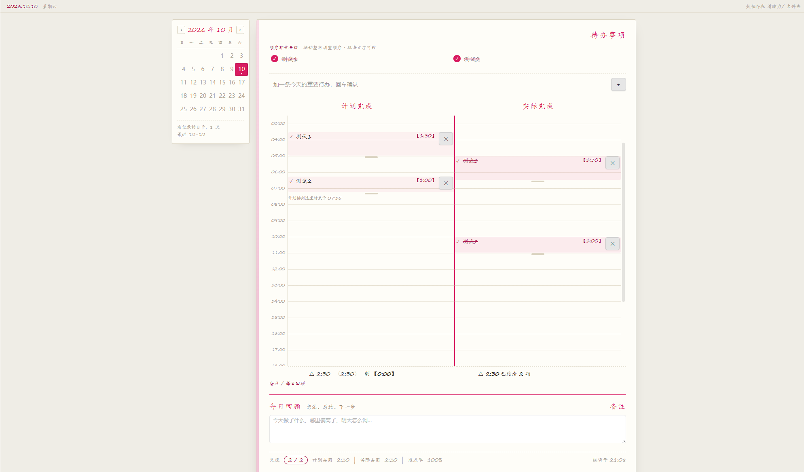

# Clarity Ledger

English | [中文](./README.zh-cn.md)

Daily clarity planner based on the **T-grid note method** (工字格笔记法) from the book
*Cognitive Awakening* by Zhou Ling. One Markdown file per day, with three linked columns —
**your data stays in your vault**, so it's searchable, git-friendly, and follows whatever sync
setup you already use.



**Desktop only — cannot be installed on mobile.** On a phone you can just read the Markdown
files in your vault; the app renders that table natively. See
[Desktop / Mobile](#desktop--mobile).

## Why Markdown instead of a database

The plugin writes each day's plan as an ordinary md file in a folder you choose
(default `清晰力/`):

```markdown
# 2026-10-10

| 待办 | 预估 | 计划 | 实际 |
|---|---|---|---|
| 改 GDD 第7章 <!--id:1--> | 1:00 | 8:00–9:00 | |
| 准备联机测试 <!--id:2--> | 0:45 | 10:30–11:15 | 10:35–11:35 |
| 还没排期的事 <!--id:3--> | 0:20 | | |

## 复盘

昨天把复习时间放太靠后……
```

This means:

- **You can edit it by hand inside the app.** The plugin notices: it compares mtime before
  writing back and treats a file you changed yourself as authoritative — it never overwrites it.
- **Everything is searchable.** Task names and review notes live in plain md, so
  `Ctrl+Shift+F` finds them.
- **You can put it under git**, and it rides along with your existing sync setup.

## How the three columns work together

| Action | Result |
|---|---|
| Drag a todo onto a time in the plan track | It occupies that slot; everything after it shifts forward |
| Drag the bottom handle | Changes the duration |
| Click ✓ on the plan track | Moves it to the **same time slot** on the actual track (not to "now") |
| Drag a block / its bottom handle on the actual track | Changes the actual start time and duration |
| Double-click a todo title | Renames it in place; all three views update |
| Delete a block on the actual track | Clears only the actual time; the schedule stays |

**Todos are the master table; the plan and actual tracks are two projections of it** — all
three views read the same data, so there is no "changed it here, forgot to sync there".

There is deliberately **no automatic time tracking**: dragging a task into "actual" already
means "done", so there is no "in progress" state and the actual duration defaults to the planned
duration.

## Installation

### Manual install (currently available)

1. Download `main.js`, `manifest.json`, and `styles.css` from the latest
   [Release](https://github.com/kelon0522/obsidian-clarity-ledger/releases)
2. Put them in `<your vault>/.obsidian/plugins/clarity-ledger/` (create that folder if needed)
3. Restart the app, then go to Settings → Community plugins → turn off Safe mode → enable
   **Clarity Ledger**
4. Click the calendar icon in the left ribbon, or press `Ctrl+P` and search "打开今天的规划"

On first enable it offers to create today's file.

### Community plugins

Once the community directory submission is approved, this section will read
"Settings → Community plugins → Browse, search for `Clarity Ledger`". Until then, use the manual
install above.

## Storage location and file naming

Settings has two options: the **storage folder** (nested paths supported) and the
**file name template**.

Template tokens: `{Y}` 4-digit year · `{YY}` 2-digit year · `{M}` 2-digit month · `{D}`
2-digit day. For example `{Y}年{M}月{D}日` names `2026-10-10` as `2026年10月10日.md`.

**Changes apply when you leave the field** (Enter works too, Esc reverts). Existing files are
**migrated automatically** to the new location and renamed by the new rule.

Migration has three hard rules:

| Rule | Why |
|---|---|
| Only files whose names resolve back to a date are moved | Anything else you keep in that folder (meeting notes, attachments) is left untouched |
| If the destination already has a file with the same name, **skip — never overwrite** | Overwriting is irreversible; skipping leaves you something you can handle |
| If every move fails, the **configuration is not changed** | Otherwise the UI points at an empty folder and it looks like all your data is gone |

After the move you're told how many were moved, skipped, and failed — and skipped files are
listed by name. If the old folder ends up empty you're told you can remove it manually; the
plugin won't delete a folder you created yourself.

## Desktop / Mobile

The plugin declares `isDesktopOnly: true`, so **it can't be installed on a phone**. Dragging uses
native HTML5 DnD, which touchscreens don't trigger, and the timeline is 960px wide — wider than
a phone screen.

On mobile, **read the Markdown in your vault directly** — the app renders that table natively, so
you can look things up, edit your review, and fill in actual times without the plugin. The data
syncs with your vault, so mobile and desktop always agree.

The plugin is the primary implementation; a Web version lives in another repository with
identical product rules.

## Privacy

- Data is written only into your own vault. **No network requests at all** — no telemetry, no
  analytics.
- No files outside the vault are read; no external services are contacted.

## Development

```bash
npm install
npm run build       # produces main.js + styles.css, then self-checks them
npm test            # 206 test cases
npm run mutation    # mutation testing: injects 17 bugs to prove the assertions still bite
```

`npm test` and `npm run mutation` are **cross-platform**: driven by node, and they run on Windows
even without Git Bash (earlier versions depended on bash outright, which shut Windows
contributors out).

See [CONTRIBUTING.md](CONTRIBUTING.md) for the code conventions of this project. For iterating on
the plugin, install [Hot-Reload](https://github.com/pjeby/hot-reload) and press `Ctrl+R`.

The build self-check **actually `require`s the built main.js** — "esbuild exited 0" does not mean
"the app can load it". Bad references, circular imports, and broken CJS wrapping only surface when
the module is loaded. The check also encodes the community directory's machine validation rules
(naming, description punctuation, and so on), so rejections get caught locally instead of in review.

`npm run mutation` is the most valuable command in this project: **"all tests pass" does not mean
"the tests are meaningful."** An assertion can match a comment instead of code (this project has
been bitten by that), or be bypassed by substring matching. The script injects known bugs one at a
time and confirms the right assertion goes red — run it after changing code to catch
"what I thought I was testing, I wasn't actually testing."

## Releasing

```bash
npm version patch     # syncs manifest.json + versions.json, tags without a v prefix
git push --tags       # triggers .github/workflows/release.yml, which builds the Release
```

Release attachments are `main.js`, `manifest.json`, and `styles.css`.

Three rules learned the hard way:

- **The tag must exactly equal the manifest `version` and carry no `v` prefix** — the app looks
  up a tag by version; a `v` prefix means users never receive updates.
- **A Release must not be a draft** — the app fetches attachments from *published* Releases over
  the API. The workflow pins `draft: false`.
- **`package-lock.json` must be committed** — the pipeline runs `npm ci`, which fails without it.

Submitting to the community directory happens once; later version updates don't need another PR.

## License

MIT, see [LICENSE](LICENSE).

Methodology from *Cognitive Awakening* by Zhou Ling.

## Related files

| File | What it's for |
|---|---|
| [README.zh-cn.md](README.zh-cn.md) | Chinese version of this document |
| [CHANGELOG.md](CHANGELOG.md) | Changes users can actually notice |
| [CONTRIBUTING.md](CONTRIBUTING.md) | How to contribute, and this project's conventions |
| [手测清单.md](手测清单.md) | Manual test checklist — run it after changing core logic |